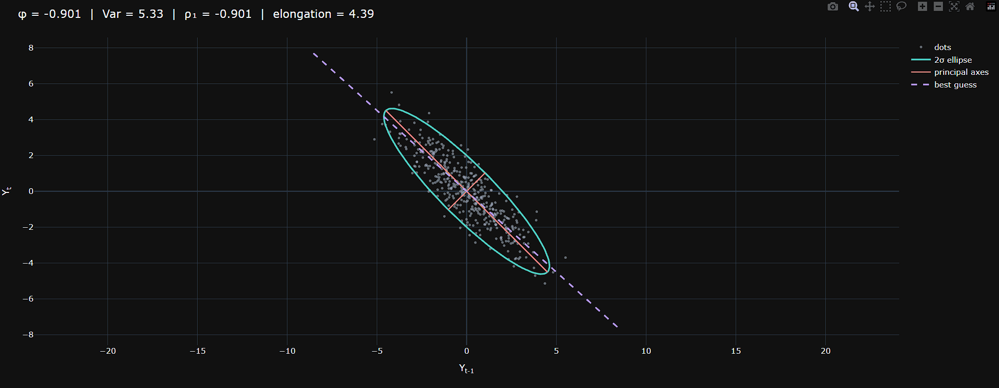
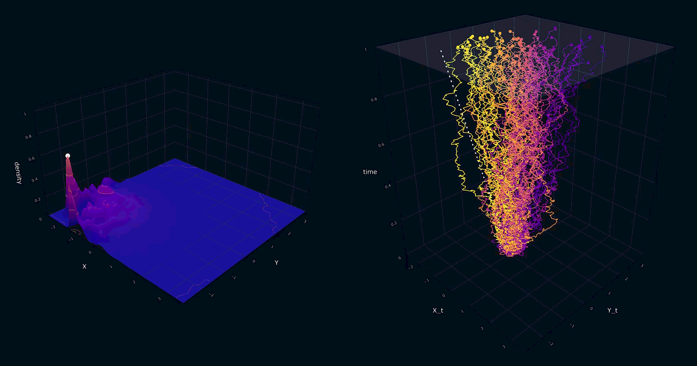
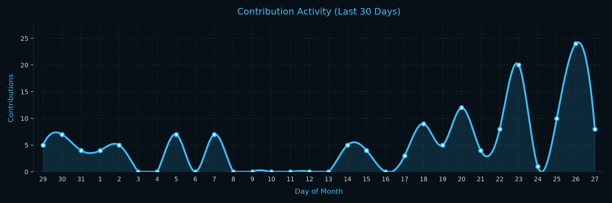

---

**Quantitative Finance · Stochastic Calculus · Scientific Computing**

*Transforming probabilistic math and statistical theory into intuitive visual systems.*

---

## 🧠 About

Trained in mathematics with a focus on **Stochastic Calculus, Statistics, and Scientific Computing**, applying rigorous theory to financial and time-series problems. My work emphasizes mathematical depth paired with visual systems that make abstract probabilistic structures intuitive.

Targeting roles in **Quantitative Research and Machine Learning**.

---

## 🎯 Focus Areas

* **Stochastic processes & derivatives pricing:** Brownian motion, SDEs, Itô calculus
* **Time-series & volatility modelling:** ARIMA, GARCH-family models, regime behaviour
* **Optimization & numerical methods:** Monte Carlo methods, numerical ODEs & PDEs

### 🔬 Current Interests

* **American Option Pricing (discrete dividend return):** Free boundary PDE (2D)
* **Bellman Equation & Dynamic Programming**
* **Numerical PDEs:** Implicit Euler, PSOR, penalty methods

---

## 🧩 Featured Projects

### 1. `lagshape` · [Repository](https://github.com/kalaapks/lagshape)

Visualizing ARMA processes in 2D or 3D in a single line of code, and diagnosing whether fitted time-series data genuinely matches an ARMA specification by comparing *cloud*-features.

  
  

`Python` · `NumPy` · `SciPy` · `statsmodels` · `Plotly`

---

### 2. `radonika` · [Repository](https://github.com/kalaapks/radonika)

Visualizing the probability law of stochastic processes along with Radon–Nikodym derivatives and changes of measure.

   
  <em>Spiral Ornstein–Uhlenbeck stochastic process</em>

   
  <em>Likelihood ratio heatmap showing where mass concentrates under P vs. Q</em>

   
  <em>Change of drift controlled by Esscher's tilt parameter θ in the browser</em>

`Python` · `NumPy` · `SciPy` · `statsmodels` · `Plotly`

---

## 🛠️ Toolkit

**Languages**

**Data & Numerical Computing**

**Quantitative Modeling & Machine Learning**

**Visualization & Workflow**

---

## Last 30 days

---

## 📬 Contact

