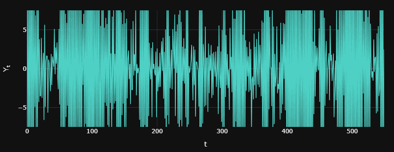
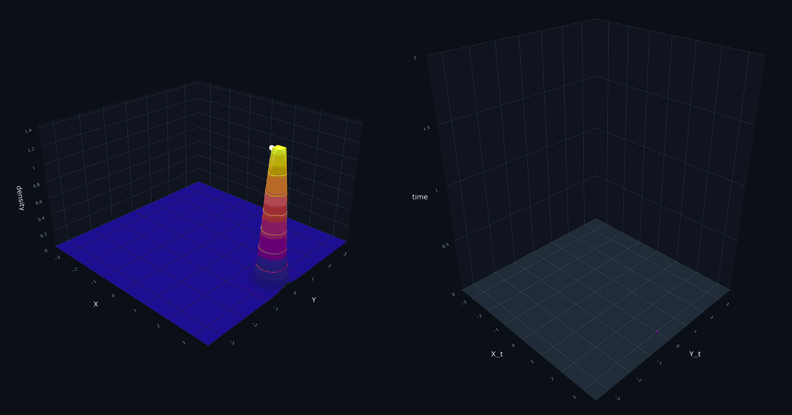

># **Kalaap Sadhu**

**Quantitative Finance · Stochastic Calculus · Scientific Computing**

*Transforming probabilistic math and statistical theory into intuitive visual systems.*

---

## About

I'm trained in mathematics with a focus on **Stochastic calculus, Statistics and Computing**, applying rigorous theory to financial and time-series problems. It is rooted in mathematical rigor with a special focus on building visual systems that make complex abstract mathematical ideas intuitive.

I want to work in **Quantitative Research and Machine Learning**.

---

## Focus Areas

- **Stochastic processes & derivatives pricing**: Brownian motion, SDEs, Itô calculus
- **Time-series & volatility modelling**: ARIMA, GARCH-family models, regime behaviour
- **Optimization & numerical methods**: Monte Carlo methods, Numerical ODEs & PDEs

### Current Interests

- **American Option Pricing** : Free boundary PDE (2D) 
- **Bellman Equation, Dynamic Programming** 
- **Numerical PDEs** : Implicit Euler, PSOR, Penalty method

---
---

## GitHub Projects Animated overview

### 1. [`lagshape` python library](https://github.com/kalaapks/lagshape)

**Stack:** Python · NumPy · SciPy  |  [Repository](https://github.com/kalaapks/lagshape)

### 2. [`radonika` python library](https://github.com/kalaapks/radonika)

**Stack:** Python · statsmodels · NumPy · SciPy · Plotly  |  [Repository](https://github.com/kalaapks/radonika)

## Toolkit

**Languages**

**Data**

**Quantitative Modeling & Machine Learning**

**Visualization & Workflow**

## Contact

